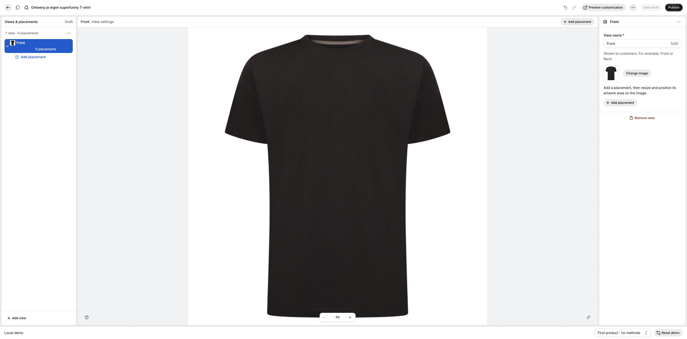
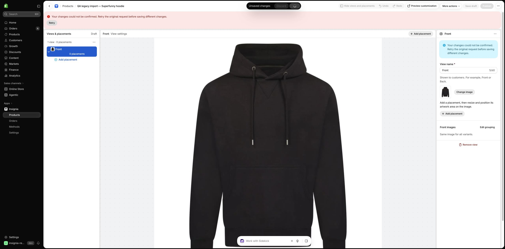
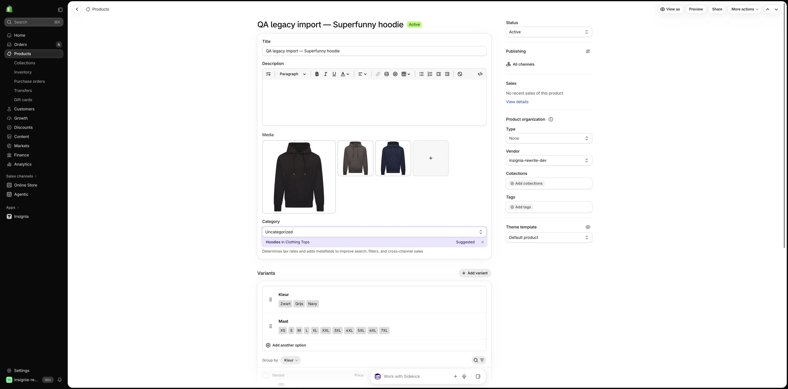
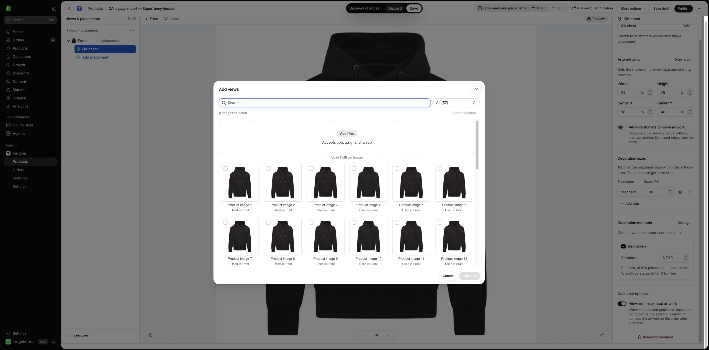
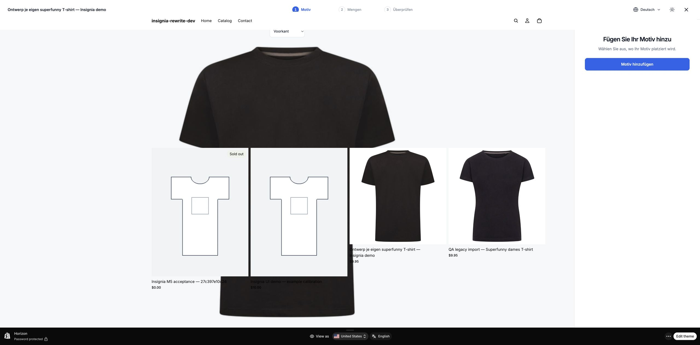
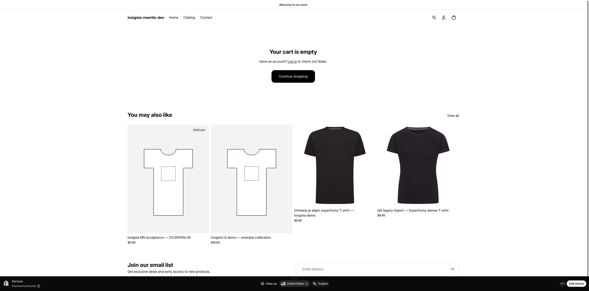
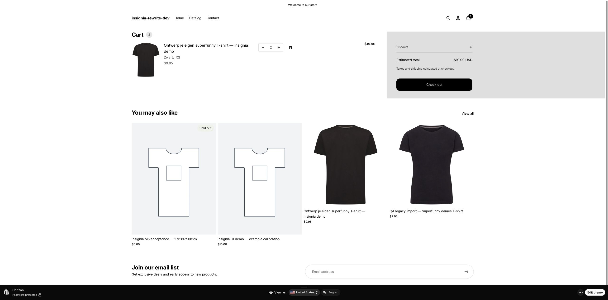

# Integrated UI qualification: round two

The approved demo is the primary reference for presentation, controls and workflow. This pass did not redesign the app against Checklist Design. Native Shopify-only behavior was checked against the agreed product flow and platform expectations. Fixture differences, host chrome and temporary first paints were filtered out.

## Current findings, in suggested repair order

| Issue | Observed behavior | Evidence and boundary |
| --- | --- | --- |
| QA-015 · P1 | A background-prepared Designer paints over Shopify's cart without an explicit open action. The parent dialog is closed, hidden and inert, but its iframe becomes visible. | Fresh isolated native replay, same-frame computed DOM styles, before/after expiry screenshots and independent Sol source review. This is a visibility defect, separate from cart pricing. |
| QA-013 · P1 | Saving the first Front view on the owned hoodie remains unconfirmed, including one exact original-request retry. | Current native editor plus read-only persistence check: the initial version-1 scaffold exists, but contains zero selected views. The requested one-view draft is not confirmed. |
| QA-002 · P1 | Intermittent Products and other admin reads fail; retry sometimes recovers. Permissions checking returned a partial result. | Native observations across routes. One issue is retained rather than one per page. Authentication, transport and schema causes have not been established. |
| QA-012 · P1 | Changing the owned customized cart line from quantity 1 to 2 changes the displayed unit price from USD 17.45 to USD 9.95 and removes the customized-cart review entry. | Independent native DOM observations after full reload. A fresh current-Designer reproduction is recorded below. Checkout was never attempted; accepted charge, carrier removal and server cause remain unproven. |
| QA-011 · P2 | Add views lists 37 entries for three actual hoodie photos, repeating featured and per-variant references. The cap independently shows 11 for five photos. | Native picker, actual Shopify gallery, DOM count and source projection. Repeated asset identity is the defect; different demo garment photos are not. |
| QA-014 · P2 | An unresolved save is shown as actively saving after the request settles, with duplicate recovery messages. | Actual native screenshot and independently checked state mapping. Pending command custody must remain; in-flight loading and unresolved custody should be separate. |

The complete continuing register is [issues.json](issues.json). Historical issues remain there with their own status and closure criteria; the six rows above are not six newly discovered root causes.

## Direct comparisons

The matched one-view, zero-placement draft settles in the demo. The native current-build editor retains the view locally but displays an unconfirmed save. The photos and Shopify outer shell differ legitimately.

Approved demo:

Integrated editor:

The actual Shopify hoodie has three photos:

The integrated picker repeats those references:

Background preparation should be invisible. These unmodified screenshots show the cart while preparation paints over it, then after the prepared frame expires naturally:

## Fresh current-Designer cart reproduction

Root opened the current rich T-shirt Designer, selected Linkerborst with the explicit USD 7.50 decoration price, deferred artwork, chose Zwart/XS quantity 1 and reviewed USD 17.45. One Add returned to Shopify. The settled cart showed USD 17.45. Increasing the native quantity once, then fully reloading, showed USD 9.95 per item and USD 19.90 total. The customized-cart review control changed from count 1 to 0 in the DOM; Checkout was enabled but never used.

Quantity 1 before the change:

Quantity 2 after the change and reload:

These files were captured after natural preparation expiry and independently inspected by Sol. They visibly establish quantity and price, while review-control counts come from DOM observations. Decreasing back to 1 restored USD 17.45 and the review entry. Root removed only its owned line; a fresh reload showed “Your cart is empty” and zero cart tables. The cleanup screenshot again showed QA-015's background painting, so it is labelled `root-round2-after-cleanup-overlay.jpg` and is not used as clean empty-cart visual proof. The earlier mixed screenshots are retained as QA-015 evidence, not price proof.

## Progress and boundaries

- All six owned QA catalog products are Active and published to Online Store. Their 261 actual variant tuples and 29 gallery photos were reconciled. This is catalog preparation, not completed Insignia configuration.
- Fresh current-build Add views X, Escape and Cancel close correctly and release the Shopify host. Historical stranded-scrim evidence came from an older open frame. Hidden zero-size scrim nodes do not themselves indicate a blocker.
- The current web bundle contains the reviewed photo decoder correction. Native PNG/JPEG upload remains unverified because browser file selection did not complete. This is not classified as another confirmed upload defect.
- The authoring smoke path exercised adding a view and placement, product-only method pricing, manual color-photo assignment and per-color alignment review. The old complex setup was never persisted. The current minimal save is blocked by QA-013; all six products are not fully configured.
- The admin pass sampled Home, Products, Methods, Settings, Billing, Permissions, Translations and Orders list/detail. Normal app entry, order search/filter/detail and action menus were checked. Counts, subscription terms and currency differences were treated as fixture data. Three existing translation category labels remain QA-005.
- Targeted checks passed 46 admin and 32 Designer runtime tests with no skips. These overlap earlier test counts and are not 78 additional distinct checks. A local customer browser attempt stopped at fixture setup and is neither a native failure nor a passing flow.
- The 73-case state inventory is a plan, not a completed pass. Narrow native layouts, all dirty-state transitions, native photo upload/readback and some production-bridge recovery paths remain unqualified.
- No checkout, payment or new app fix/deployment was performed in this round. Superfunny remained read-only. Only owned dev catalog products and test cart lines were changed.

## Next qualification pass

Repair hidden preparation and first-save/read recovery in separate bounded changes. Retest each against its exact native reproduction, then resume manual authoring on the six dev copies. Trace native quantity compatibility separately, preserving purchase and validation guards. Complete photo upload/readback, current mobile parity and the unexercised production-bridge recovery cases before claiming full qualification.

Detailed records: [root run](root-round2.md), [admin run](admin-round2.md), [buyer run](buyer-round2.md), [state review](state-integration-round2.md), [independent Sol review](round2-sol-review.md), [catalog publication](catalog-publication-round2.json).
